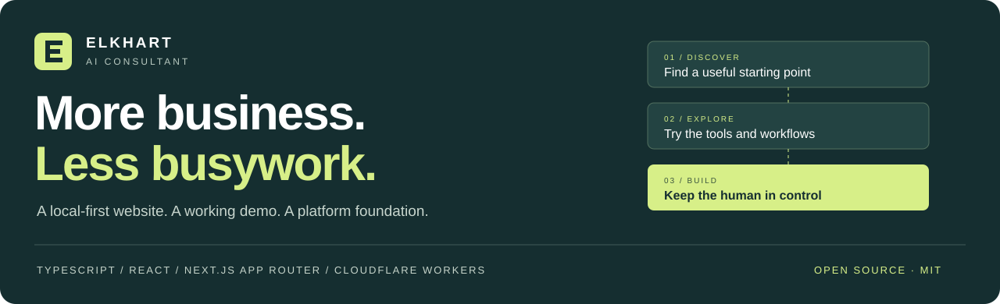
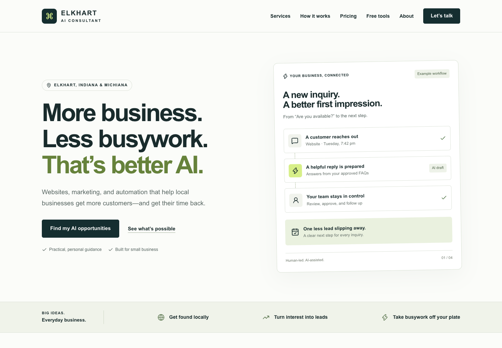
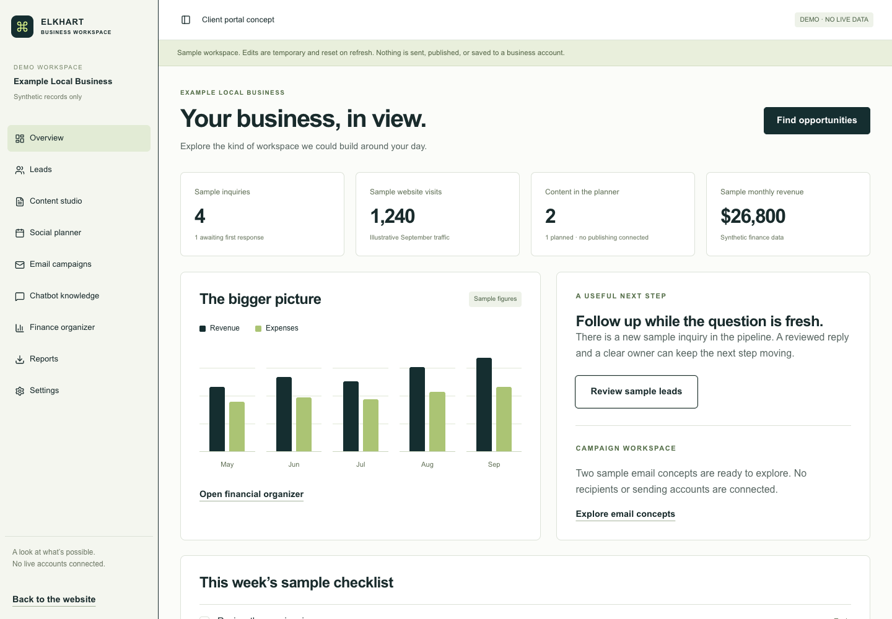
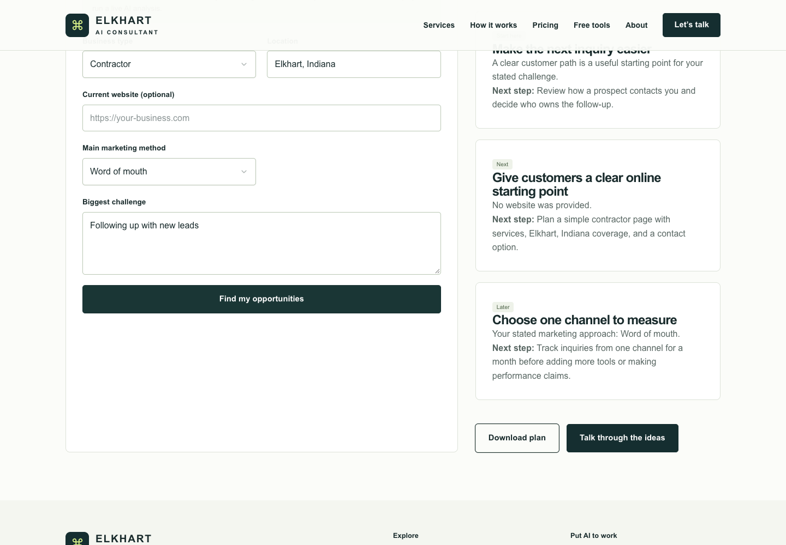
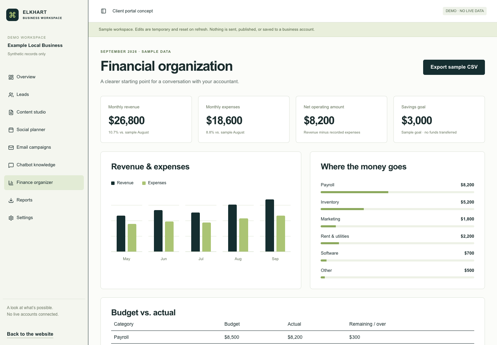
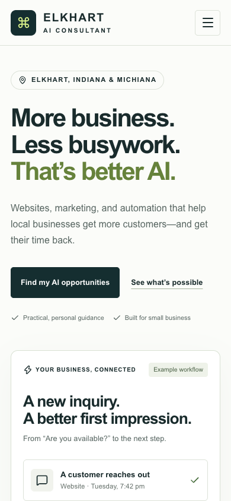
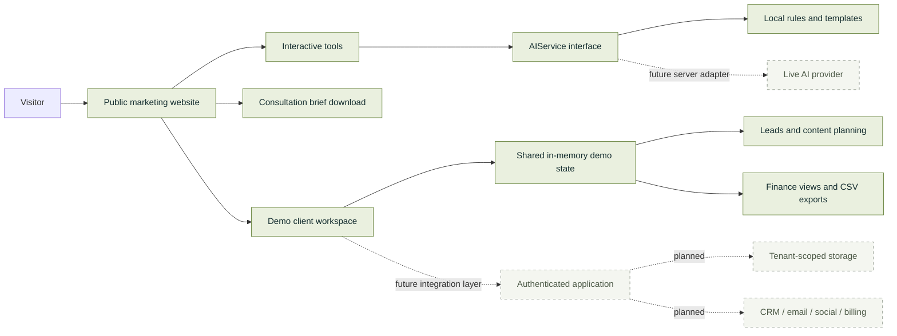

<div align="center">



# Elkhart AI Consultant

### Practical AI for the businesses that make a community work.

**A polished consulting website + interactive business tools + a modular client-workspace demo.**  
Built for Elkhart, Indiana and Michiana. Designed for developers to explore, adapt, and extend.

[](https://github.com/Skeeb32/elkhart-ai-consultant/actions/workflows/ci.yml)
[](LICENSE)
[](package.json)
[](package.json)
[](https://github.com/Skeeb32/elkhart-ai-consultant/stargazers)
[](https://github.com/Skeeb32/elkhart-ai-consultant/forks)

[**Explore the screenshots**](#a-look-inside) · [**Run it locally**](#quick-start) · [**Architecture**](#built-to-grow-with-the-product) · [**Contribute**](#build-the-next-useful-piece)

</div>

> [!IMPORTANT]
> **This is a working demo foundation, not an operational SaaS service.** AI experiences use local rules and templates. Dashboard records are synthetic. There is no live model, customer authentication, persistent customer database, email delivery, social publishing, billing, or accounting connection. Demo edits reset on refresh. The consultation form prepares a download; it does not submit an inquiry.

## A look inside

### A local business website with a clear next step



A consistent visual system carries through **13 service pages**, example pricing, an opportunity finder, educational articles, and a consultation brief builder. No fabricated customers, testimonials, or performance claims.

### A separate workspace for the bigger product vision



<table>
<tr>
<td width="50%" valign="top">
<strong>Answer a few questions. Explore a starting point.</strong><br/><br/>

<br/>A rules-based audit responds to the visitor’s inputs and exports a sample plan. It never pretends to inspect a website.
</td>
<td width="50%" valign="top">
<strong>Organize the numbers. Keep the context.</strong><br/><br/>

<br/>Synthetic financial records power charts, category breakdowns, and downloadable reports—with explicit limits on what the figures mean.
</td>
</tr>
</table>

<details>
<summary><strong>See the mobile homepage</strong></summary>
<br/>
<p align="center"></p>
</details>

*Screenshots show the actual local application. The dashboard’s business figures are sample data, not project analytics or client results.*

## Why this project exists

A local business owner rarely starts with “I need an AI platform.” They start with a missed inquiry, an outdated website, an inconsistent content routine, or hours spent copying information between tools.

This project makes those problems tangible. The public website explains useful outcomes in plain language. Interactive demos let visitors explore an idea. A separate workspace shows how leads, content, approvals, knowledge, and reporting could fit together.

For developers, it is a product-shaped foundation with reusable components, editable business configuration, provider boundaries, and a documented path toward a real client application.

## Explore what works today

| Experience | What you can actually do | Boundary |
| :--- | :--- | :--- |
| **Marketing website** | Browse 13 service pages, three example plans, FAQs, local positioning, and eight field notes | Prices are illustrative; testimonials are explicitly placeholders |
| **Opportunity finder** | Enter business context, receive three sample priorities, download a plan | Rules-based; no website crawling or live model |
| **Content studio** | Choose a theme, platform, and tone; generate, edit, copy, and download a sample draft | Local templates; human review required |
| **Business calculators** | Model conversion changes, cost per lead, acquisition cost, and revenue return | Scenario arithmetic; not forecasts or profit calculations |
| **Automation finder** | Select recurring tasks and explore matching workflow ideas | Suggestions do not create automations |
| **Lead pipeline** | Search, filter, update sample statuses, and export the visible records | In-memory, fictional contacts |
| **Social planner** | Draft → edit → approve → select a future time → view in a calendar | Planning only; no background publishing job |
| **Email & chatbot demos** | Prepare sample email copy; add FAQ entries and test answers with an escalation fallback | No email delivery; chatbot uses normalized exact matching |
| **Finance & reports** | Inspect sample budgets and trends; download ten report types as CSV | CSV, not native XLSX; organization only |
| **Consultation brief** | Validate a form and download a structured brief | Nothing is sent; configured email links open a draft |

**Try a complete flow:** open `/dashboard/social`, add a draft, approve it, choose a future time, and add it to the plan. Editing the text returns it to **Draft**, so approval must happen again.

## Built to grow with the product



**Solid lines are implemented flows. Dashed lines are future work.**

### Engineering decisions worth exploring

- **Separate product surfaces.** `app/(marketing)` and `app/dashboard` have distinct layouts. The public content can evolve independently of future account workflows.
- **Provider-neutral contracts.** [`AIService`](lib/ai/types.ts) covers content, email, social posts, SEO, business recommendations, customer replies, and expense summaries. The current implementation declares its `demo` mode.
- **Honest integration failures.** Unconnected CRM, email, and social adapters throw [`NotConnectedError`](lib/integrations/contracts.ts), instead of returning a fake external success.
- **Explicit approval transitions.** The social planner distinguishes drafts, approvals, and planned content. Content changes invalidate approval, and planning requires a future date.
- **Domain-aware calculations.** Zero denominators produce “Not available”; impossible input combinations are rejected. Exported text is quoted and guarded against spreadsheet formula injection.
- **Maintainable business content.** Services, pricing, industries, FAQs, themes, articles, and sample records live in `config/`, rather than inside a giant page component.
- **Accessible interface building blocks.** Semantic HTML, labels, keyboard-capable shadcn/Radix controls, visible focus, a skip link, and reduced-motion styling. These are implemented features, not a claim of accessibility certification.
- **SEO foundations.** Per-page metadata, Open Graph fields, service-area structured data, sitemap, robots rules, and `noindex` on demo workspace pages.

### Stack, with the details that matter

| Layer | Implementation |
| :--- | :--- |
| Language & UI | TypeScript 5.9, React 19, Next.js 16 App Router APIs |
| Styling & components | Tailwind CSS 4, CSS design tokens, shadcn/ui, Radix primitives, Lucide icons |
| Build & runtime | Vinext `1.0.0-beta.5`, Vite 8, Cloudflare Workers-compatible output, Wrangler |
| State | React local state and a shared demo context; no persistent customer storage |
| Tests & CI | Node test runner, TypeScript checks, production build, GitHub Actions workflow |
| Data architecture | Typed domain models and a proposed PostgreSQL schema; no database is provisioned |

> [!NOTE]
> The application uses **Next.js APIs through the Vinext adapter**. It is not a standard Vercel deployment, and the adapter is a beta dependency. Test compatibility before changing runtimes. Drizzle and optional D1 scaffolding come from the starter; they are not an active customer database.

## Quick start

**Prerequisites:** Git, npm, and Node.js **22.13 or newer**. Node **24** is used by `.nvmrc` and CI. No AI key or cloud account is required for the local demos.

### 1. Clone and install

```bash
git clone https://github.com/Skeeb32/elkhart-ai-consultant.git
cd elkhart-ai-consultant
npm ci
```

If you use `nvm`, run `nvm use` before installing. Keep optional dependencies enabled; the build uses platform-specific packages.

### 2. Configure the local environment

```bash
cp .env.example .env.local
```

PowerShell equivalent: `Copy-Item .env.example .env.local`.

For a local-only preview, set this public URL in `.env.local`:

```dotenv
NEXT_PUBLIC_SITE_URL=http://127.0.0.1:5173
```

| Variable | Purpose | Default behavior |
| :--- | :--- | :--- |
| `NEXT_PUBLIC_SITE_URL` | Absolute origin for metadata and sitemap | Project’s configured Sites origin |
| `NEXT_PUBLIC_CONTACT_EMAIL` | Verified business email | Email action hidden when empty |
| `NEXT_PUBLIC_CONTACT_PHONE` | Verified business phone | Call action hidden when empty |
| `NEXT_PUBLIC_BOOKING_URL` | Verified HTTPS booking destination | Scheduling shown as unconnected when empty |
| `AI_PROVIDER` | Reserved future configuration | `mock`; changing it does not install a live adapter |

`NEXT_PUBLIC_` values are public. **Never put credentials in them.** `.env*` files are ignored; `.env.example` is intentionally tracked.

### 3. Start the application

```bash
npm run dev
```

Open the local URL printed in the terminal, normally **http://127.0.0.1:5173**.

| Visit | Explore |
| :--- | :--- |
| `/` | Marketing homepage |
| `/services` and `/pricing` | Service catalog and configurable example plans |
| `/ai-audit` | Business opportunity finder |
| `/tools` | Content generator, calculators, and automation finder |
| `/contact` | Consultation brief builder |
| `/dashboard` | Demo client workspace |
| `/dashboard/social` | Approval and calendar flow |
| `/dashboard/finance` and `/dashboard/reports` | Synthetic finance views and CSV exports |
| `/blog` | Eight local-business field notes |

### 4. Verify and build

```bash
npm run typecheck
npm test
npm run build
npm start
```

With a server running, `npm run test:routes` checks all 41 application URLs, metadata endpoints, and invalid-route responses. To target the built preview, pass its printed origin: `npm run test:routes -- http://127.0.0.1:8787`.

`npm start` serves the built Worker locally through Wrangler. Use the URL it prints. It **does not deploy** the application.

<details>
<summary><strong>Troubleshooting a local setup</strong></summary>

- **Node version errors:** switch to Node 24, then run `npm ci` again.
- **Port already in use:** use `npm run dev -- --port 5174` and open the printed URL.
- **Unwritable npm cache:** choose a writable cache for that install, for example `npm ci --cache ./work/npm-cache`.
- **Missing native package:** reinstall without `--omit=optional`; do not copy `node_modules` between operating systems.
- **Preview values reset:** expected. The workspace stores demo edits in memory.
- **No inquiry received:** expected. The contact form downloads a brief and does not send it.

</details>

## Find your way around

```text
app/
├── (marketing)/          # Public pages, service details, field notes, tools
├── dashboard/            # Separate demo portal layout and module routes
├── sitemap.ts            # Public route discovery
└── robots.ts             # Crawler guidance
components/
├── marketing/            # Header, sections, pricing, contact form
├── tools/                # Audit, drafts, calculators, automation ideas
├── dashboard/            # Workspace shell, shared state, modules
└── ui/                   # Included shadcn primitives
config/                   # Services, plans, FAQs, industries, articles, demo records
lib/
├── ai/                   # AIService contract and local mock implementation
├── integrations/         # CRM, email, social, finance, analytics boundaries
├── calculations.ts       # Validated arithmetic and CSV escaping
└── domain.ts             # Future business/tenant-aware types
docs/                     # Architecture, launch notes, schema proposal, screenshots
tests/                    # Core behavior tests
.github/workflows/ci.yml   # Typecheck → test → build
```

## Evidence over inflated numbers

| Repository fact | Where to verify it |
| :--- | :--- |
| **13** configurable service definitions | [`config/services.ts`](config/services.ts) |
| **5** public interactive tools | [`components/tools/`](components/tools) |
| **9** workspace modules | [`config/demo.ts`](config/demo.ts) |
| **10** downloadable report types | [`components/dashboard/reports.tsx`](components/dashboard/reports.tsx) |
| **8** educational articles | [`config/articles.ts`](config/articles.ts) |
| **11** core tests | [`tests/core.test.mjs`](tests/core.test.mjs) |
| Package version **0.1.0** | [`package.json`](package.json); not a claim of a tagged release |

[](https://github.com/Skeeb32/elkhart-ai-consultant/commits/main)
[](https://github.com/Skeeb32/elkhart-ai-consultant/graphs/contributors)
[](https://github.com/Skeeb32/elkhart-ai-consultant/issues)

Repository activity badges update from GitHub; they are not hard-coded popularity claims. CI reports the workflow’s actual status. No coverage percentage, performance benchmark, active-user count, or production uptime is claimed. See the [verification record](docs/VERIFICATION.md) for the scope of local checks.

## From demo foundation to real client platform

- [x] Responsive marketing website and reusable design system
- [x] Service catalog, configurable pricing, local content, and SEO foundations
- [x] Interactive rules-based tools and editable content drafts
- [x] Separate workspace with synthetic leads, approvals, calendar, FAQ, and finance views
- [x] CSV exports, edge-case tests, and build verification
- [x] Provider contracts, domain types, security notes, and schema proposal
- [ ] Verified business identity, contact details, final prices, and public launch review
- [ ] Durable lead intake with consent, abuse protection, and delivery confirmation
- [ ] Server-side authentication, memberships, and tenant authorization
- [ ] Reviewed migrations, backups, retention, and deletion workflows
- [ ] Live AI adapters, quotas, evaluation, and tenant-isolated retrieval
- [ ] OAuth integrations, encrypted tokens, durable queues, and publishing audit logs
- [ ] Subscription entitlements and signed, idempotent billing webhooks
- [ ] Expanded end-to-end automation and formal accessibility/performance review

The [architecture guide](docs/ARCHITECTURE.md) explains the boundaries. The [launch checklist](docs/LAUNCH.md) explains what must change before real customer use.

### Deployment

The current checkout includes Sites hosting configuration in [`.openai/hosting.json`](.openai/hosting.json). A Sites deployment is a separate action from `npm run build` or `npm start`.

For the existing project, use the Sites publishing workflow from its authorized workspace: verify the source, build the Worker, push the matching source commit, package the output, and deploy the saved version. Initial hosting is private; do not describe it as a public demo until access is deliberately changed.

For a fork, create your own hosting project and replace the project identity through that provider’s setup flow. Do not reuse the original project’s identity or credentials. Configure the final origin and verified contact destinations, rebuild, and complete the [launch checklist](docs/LAUNCH.md). The repository does not include a universal one-command public deployment or automatic deployment from CI.

## For engineers and hiring teams

This project demonstrates **product-oriented frontend engineering with explicit integration boundaries**:

| Skill | Concrete evidence |
| :--- | :--- |
| Product and interface architecture | Separate marketing and dashboard layouts, reusable modules, configuration-driven pages |
| Typed system design | Provider contracts, domain models, mock/live result metadata, explicit unsupported operations |
| Workflow design | Draft approval invalidation, future-date validation, filtered exports, empty and failure states |
| Defensive data handling | Formula-safe CSV cells, numeric input guards, honest zero-denominator behavior |
| UX implementation | Responsive layouts, accessible primitives, editable drafts, downloadable artifacts, meaningful feedback |
| Delivery discipline | Lockfile, environment template, CI definition, tests, runtime-specific deployment notes, real application screenshots |

**A useful review path:** [`AIService`](lib/ai/types.ts) → [`social planner`](components/dashboard/social.tsx) → [`calculations`](lib/calculations.ts) → [`tests`](tests/core.test.mjs) → [`architecture`](docs/ARCHITECTURE.md).

This demonstrates an implemented foundation—not production scale, security certification, or completed third-party integrations.

## Build the next useful piece

Contributions that make the product clearer, more reliable, or easier to extend are welcome.

1. [Open an issue](https://github.com/Skeeb32/elkhart-ai-consultant/issues/new) for a substantial change or reproducible bug.
2. Fork the repository, clone your fork, and follow the quick start.
3. Create a branch: `git switch -c feat/your-improvement`.
4. Keep the change focused. Preserve honest demo labels and explicit external side effects.
5. Run `npm run typecheck`, `npm test`, and `npm run build`.
6. Open a pull request with the problem, implementation, verification, and screenshots for UI changes.

Good starting points include keyboard-navigation improvements, calculator edge cases, clearer examples, focused browser tests, and additional industry configuration. Larger authentication or live-provider changes should start with a design discussion in an issue.

Read [CONTRIBUTING.md](CONTRIBUTING.md) and [SECURITY.md](SECURITY.md). Never include secrets or customer records in a contribution or public issue. Financial views support organization and planning; they do not provide professional financial, accounting, tax, investment, or legal advice.

---

<div align="center">

### Make useful technology easier to reach.

**⭐ Star** to help people discover it. **Fork** to adapt it to your community.  
**Try a workflow. Open an issue. Build the next useful piece.**

[Explore the code](https://github.com/Skeeb32/elkhart-ai-consultant) · [Report an issue](https://github.com/Skeeb32/elkhart-ai-consultant/issues) · [View contributors](https://github.com/Skeeb32/elkhart-ai-consultant/graphs/contributors)

[MIT licensed](LICENSE) · Built around real business problems · Humans stay in control

</div>
